# Planificación de procesos: estudio de MLFQ y puesta a punto de XV6

**Universidad del Valle**, Facultad de Ingeniería
**Curso:** Sistemas Operativos
**Profesor:** John Alexander Sanabria Ordoñez
**Fecha de entrega:** 16 de noviembre de 2026

**Integrantes:**
- Samuel David Duarte Soto, código 2535902
- Nohaysi Montaño, código 2537370

**Repositorio (fork):** [https://github.com/duartesamuel-alt/xv6-riscv](https://github.com/duartesamuel-alt/xv6-riscv)

---

## Contenido

1. [Preparar el repositorio y el entorno](#1-preparar-el-repositorio-y-el-entorno)
2. [Compilar y ejecutar XV6](#2-compilar-y-ejecutar-xv6)
3. [Investigar el planificador original](#3-investigar-el-planificador-original)
4. [Describir MLFQ y explorar su incorporación](#4-describir-mlfq-y-explorar-su-incorporación)
5. [Evidencia del aprendizaje con IA](#5-evidencia-del-aprendizaje-con-ia)
6. [Bibliografía](#6-bibliografía)

---

## 1. Preparar el repositorio y el entorno

### 1.1 Fork y revisión de partida

Creamos un fork del repositorio oficial [mit-pdos/xv6-riscv](https://github.com/mit-pdos/xv6-riscv) en [duartesamuel-alt/xv6-riscv](https://github.com/duartesamuel-alt/xv6-riscv):

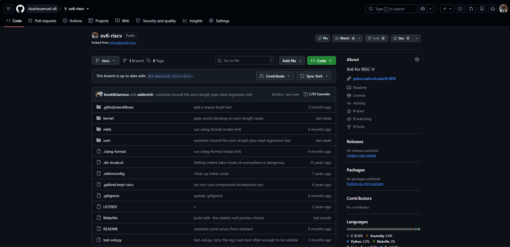

Luego, dentro de una máquina virtual Linux administrada con Vagrant desde Windows, instalamos git y clonamos el fork:

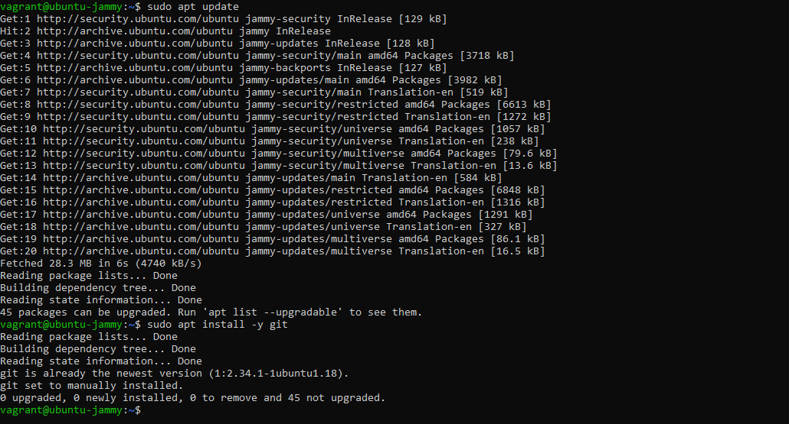

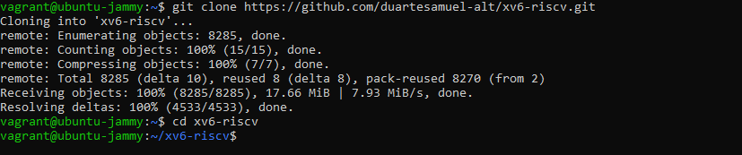

**i. Versión de Linux donde se clonó el código fuente:** Ubuntu 22.04.5 LTS (*jammy*).

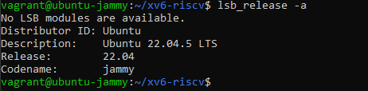

**ii. Commit de partida:**

```
fa2ddcb7ca87a77af579380a6eafd5aff163b44f
```

Es el último commit de la rama `riscv` en el momento de clonar (*"usertests: bound the zero-length pipe read regression test"*, 30 de octubre de 2026).

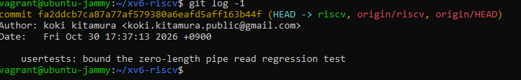

### 1.2 Herramientas necesarias y sus versiones

**i. Herramientas identificadas.** Según la documentación del curso 6.1810 del MIT (página *Tools*) y el `README` del repositorio, para Ubuntu se necesitan:

```bash
sudo apt install -y build-essential gdb-multiarch qemu-system-misc gcc-riscv64-linux-gnu binutils-riscv64-linux-gnu
```

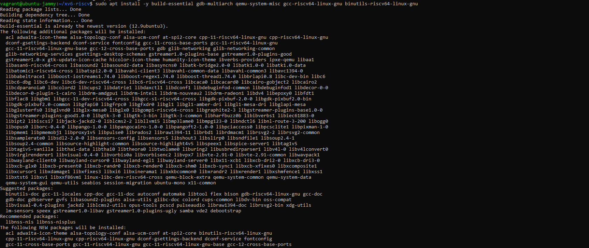

| Herramienta | Para qué sirve |
|---|---|
| `gcc-riscv64-linux-gnu`, `binutils-riscv64-linux-gnu` | Compilador, ensamblador y enlazador cruzados: generan código para RISC-V de 64 bits desde nuestro equipo x86. |
| `qemu-system-riscv64` | Emulador que simula una máquina RISC-V (`virt`) donde se ejecuta XV6. |
| `build-essential` (`make`) | Ejecuta las reglas del `Makefile` para construir el kernel, los programas de usuario y la imagen del sistema de archivos. |
| `gdb-multiarch` | Depurador (opcional). |

**ii. Versiones usadas para compilar y ejecutar XV6:**

| Herramienta | Versión |
|---|---|
| riscv64-linux-gnu-gcc | 11.4.0 (Ubuntu 11.4.0-1ubuntu1~22.04) |
| QEMU (`qemu-system-riscv64`) | 8.2.2 (compilado desde el código fuente, ver abajo) |
| GNU Make | 4.3 |
| git | 2.34.1 |

Versiones finales, con las que compilamos y ejecutamos XV6:

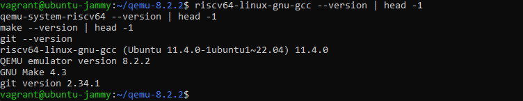

**Problema encontrado y solución.** La primera vez, Ubuntu 22.04 instaló QEMU 6.2.0 desde `apt`:

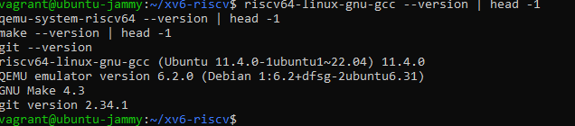

Pero el `Makefile` de XV6 (regla `check-qemu-version`, línea 198) exige QEMU ≥ 7.2, así que `make qemu` falló:

```
ERROR: Need qemu version >= 7.2
make: *** [Makefile:198: check-qemu-version] Error 1
```

Lo resolvimos compilando QEMU 8.2.2 desde el código fuente, solo para RISC-V. Durante la compilación, la máquina virtual se quedó sin memoria (`cc1: Killed signal terminated program`), así que agregamos un archivo *swap* de 2 GB y compilamos con un solo proceso (`make` sin `-j`).

### 1.3 Instrucciones reproducibles

```bash
# 1. Clonar el fork
git clone https://github.com/duartesamuel-alt/xv6-riscv.git
cd xv6-riscv

# 2. Herramientas
sudo apt update
sudo apt install -y git build-essential gdb-multiarch qemu-system-misc gcc-riscv64-linux-gnu binutils-riscv64-linux-gnu

# 3. QEMU >= 7.2 (solo necesario si apt instala una versión anterior, como en Ubuntu 22.04)
sudo apt install -y ninja-build pkg-config libglib2.0-dev libpixman-1-dev python3-venv python3-pip flex bison wget xz-utils
cd ~
wget https://download.qemu.org/qemu-8.2.2.tar.xz
tar xf qemu-8.2.2.tar.xz && cd qemu-8.2.2
./configure --target-list=riscv64-softmmu
# si la VM tiene poca memoria:
sudo fallocate -l 2G /swapfile && sudo chmod 600 /swapfile && sudo mkswap /swapfile && sudo swapon /swapfile
make && sudo make install && hash -r
qemu-system-riscv64 --version   # debe mostrar 8.2.2

# 4. Compilar y ejecutar XV6 con una sola CPU virtual
cd ~/xv6-riscv
make CPUS=1 qemu
# dentro de XV6: ls, cat README, rrtest
# salir de QEMU: Ctrl+A y luego X
```

---

## 2. Compilar y ejecutar XV6

### 2.1 Evidencia de que XV6 está operativo

Compilamos y ejecutamos con `make qemu`. El kernel arranca (`xv6 kernel is booting`), se inicia la shell (`init: starting sh`) y aparece el indicador `$`.

La siguiente imagen muestra el arranque y dos comandos:
- **`ls`:** lista los archivos y programas del sistema de archivos de XV6 (`cat`, `echo`, `ls`, `sh`, etc., además del `README`).
- **`cat README`:** muestra el contenido del archivo `README`, que fue copiado a la imagen del sistema de archivos (`fs.img`) durante la construcción.


Final de la salida de `cat README`, con la shell de XV6 (`$`) esperando otro comando:

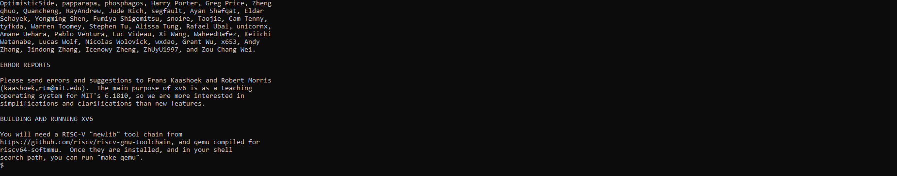

### 2.2 Ejecución con una sola CPU virtual

**i. Cómo se establece el número de CPU.** El número de CPU virtuales se define en el `Makefile` (líneas 174 a 178): la variable `CPUS` vale 3 por defecto y se pasa a QEMU con la opción `-smp $(CPUS)`.

```makefile
174  ifndef CPUS
175  CPUS := 3
...
178  QEMUOPTS = -machine virt -bios none -kernel $K/kernel -m 128M -smp $(CPUS) -nographic
```

**ii. Comando usado.** Para ejecutar XV6 con una sola CPU virtual, sin modificar archivos, usamos:

```bash
make CPUS=1 qemu
```

**Evidencia:**
1. La línea de ejecución de QEMU contiene `-smp 1`.
2. Durante el arranque no aparecen los mensajes `hart 1 starting` ni `hart 2 starting`, que sí aparecen con 3 CPU ("hart" es el nombre de cada núcleo en RISC-V).
3. En el monitor de QEMU (`Ctrl+A` y luego `C`), el comando `info cpus` muestra una única CPU (`* CPU #0`).

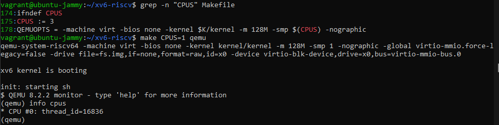

---

## 3. Investigar el planificador original

### 3.1 (i) ¿Qué algoritmo de planificación usa XV6 por defecto y cómo se evidencia?

XV6 usa por defecto una política **Round Robin (turno rotativo) apropiativa**: todos los procesos listos (`RUNNABLE`) tienen la misma importancia y se turnan la CPU en el orden de la tabla de procesos. Cada uno puede usarla como máximo durante un **quantum**, que equivale a **un tick del reloj**. Cuando el quantum se acaba, el kernel le quita la CPU y se la da al siguiente.

**Evidencia en el código:**
- `scheduler()` (`kernel/proc.c`, líneas 445 a 463) recorre la tabla `proc[]` en orden circular, sin prioridades. Elige cualquier proceso `RUNNABLE` y, cuando este devuelve la CPU, continúa con el siguiente de la tabla.
- La interrupción del reloj se programa en `kernel/trap.c` (línea 179) cada 1.000.000 de unidades del contador de tiempo. Cuando llega, `usertrap()` llama a `yield()` (líneas 85 y 86), que deja al proceso en `RUNNABLE` y devuelve la CPU al planificador. Este mecanismo es lo que hace al algoritmo **apropiativo**: el proceso no decide cuándo soltar la CPU.

**Evidencia en el comportamiento (experimento).** Escribimos el programa [`user/rrtest.c`](user/rrtest.c) y lo agregamos a la lista `UPROGS` del `Makefile` (línea 150). El programa crea **3 procesos hijos que solo usan CPU** (un ciclo de sumas, sin entrada ni salida). Cada hijo hace 5 "vueltas" de trabajo y, al terminar cada una, imprime el tick actual (`uptime()`), su número y su `pid`. Lo ejecutamos con una sola CPU (`make CPUS=1 qemu`) para que los tres compitan por el mismo procesador.

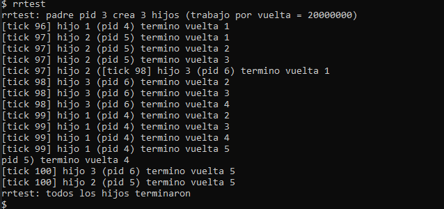

Queríamos distinguir entre dos hipótesis:
- Con **FIFO** (atender cada proceso hasta que termine), veríamos las 5 vueltas del hijo 1, luego las 5 del hijo 2 y luego las del hijo 3.
- Con **Round Robin**, veríamos a los hijos alternarse y a cada uno ser interrumpido al acabarse su quantum.

| Tick | Proceso con la CPU | Vueltas completadas |
|---|---|---|
| 96 | hijo 1 (pid 4) | vuelta 1 |
| 97 | hijo 2 (pid 5) | vueltas 1, 2 y 3 (y es interrumpido escribiendo la 4) |
| 98 | hijo 3 (pid 6) | vueltas 1, 2, 3 y 4 |
| 99 | hijo 1 (pid 4) | vueltas 2, 3, 4 y 5 (termina) |
| 99–100 | hijo 2 (pid 5) | termina de escribir la vuelta 4 |
| 100 | hijo 3 (pid 6) | vuelta 5 (termina) |
| 100 | hijo 2 (pid 5) | vuelta 5 (termina) |

1. **Los procesos se turnan en orden circular** (hijo 1 → hijo 2 → hijo 3 → hijo 1 → …), igual que el recorrido de la tabla en `scheduler()`. Ningún hijo hace las 5 vueltas seguidas, así que **no es FIFO**.
2. **Cada turno dura aproximadamente un tick**, el quantum definido por la interrupción del reloj.
3. **Prueba de la apropiación:** en la línea `[tick 97] hijo 2 ([tick 98] hijo 3 (pid 6) termino vuelta 1`, el hijo 2 fue interrumpido a mitad de su mensaje y el hijo 3 tomó la CPU. Más abajo aparece `pid 5) termino vuelta 4`: es el hijo 2 terminando su frase cuando recuperó la CPU. Un proceso no se detiene por su cuenta a mitad de una frase; fue la interrupción del reloj (`yield()`) la que lo sacó. Además, el hijo 2 continuó exactamente donde iba, lo que corresponde al cambio de contexto con `swtch()`.
4. Cuando el hijo 1 terminó, los dos restantes siguieron turnándose. Los procesos que no están en `RUNNABLE` (el padre esperando en `wait()` o un hijo que ya terminó) no vuelven a ser elegidos.

**Límites de la observación:** el trabajo por vuelta (20.000.000 de iteraciones) resultó menor que un quantum, por eso un hijo completa varias vueltas en un mismo tick. `uptime()` solo mide en ticks, así que no podemos ver el instante exacto de cada cambio. Además, el `printf` de usuario de XV6 no escribe la línea completa de una sola vez, por lo que un mensaje puede quedar partido. Eso, que parece un error, es justamente lo que deja ver la apropiación.

### 3.2 (ii) ¿En qué archivo y función se selecciona el siguiente proceso que entra a la CPU?

La selección se hace en la función **`scheduler()`**, en **`kernel/proc.c` (líneas 421 a 470)**.

La encontramos con `grep -n "scheduler" kernel/*.c kernel/*.h`:

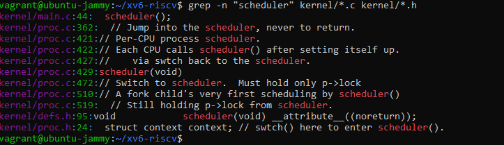

La búsqueda muestra tres lugares importantes:
- `kernel/defs.h`: la **declaración** de la función.
- `kernel/proc.c`: la **definición**.
- `kernel/main.c` (línea 44): la **llamada**. Al final de `main()`, cada CPU entra al planificador y nunca sale de ahí.

```c
421  // Per-CPU process scheduler.
422  // Each CPU calls scheduler() after setting itself up.
423  // Scheduler never returns.  It loops, doing:
424  //  - choose a process to run.
425  //  - swtch to start running that process.
426  //  - eventually that process transfers control
427  //    via swtch back to the scheduler.
428  void
429  scheduler(void)
430  {
431    struct proc *p;
432    struct cpu *c = mycpu();
433
434    c->proc = 0;
435    for (;;) {
441      intr_on();
442      intr_off();
443
444      int found = 0;
445      for (p = proc; p < &proc[NPROC]; p++) {
446        acquire(&p->lock);
447        if (p->state == RUNNABLE) {
451          p->state = RUNNING;
452          c->proc = p;
453          swtch(&c->context, &p->context);
454
456          mycpu()->intena = 0;
457
460          c->proc = 0;
461          found = 1;
462        }
463        release(&p->lock);
464      }
465      if (found == 0) {
467        asm volatile("wfi");
468      }
469    }
470  }
```
*(Se omitieron algunas líneas de comentarios.)*

**Explicación.** El comentario de las líneas 421 a 427 resume el funcionamiento: cada CPU llama a `scheduler()` después de inicializarse, la función nunca retorna y repite siempre tres pasos: elegir un proceso, cambiar a él con `swtch` y esperar a que le devuelva el control.

La función es un ciclo infinito (`for (;;)`, línea 435). En cada vuelta recorre en orden la tabla `proc[]` (línea 445), de `NPROC` = 64 posiciones. Para cada proceso:

1. Toma su candado (`acquire(&p->lock)`, línea 446) para que ninguna otra parte del kernel lo modifique al mismo tiempo.
2. Revisa si está listo (`p->state == RUNNABLE`, línea 447). Si no lo está, lo salta.
3. Si está listo, lo cambia a `RUNNING` (línea 451) y registra en la CPU cuál proceso está ejecutando (`c->proc = p`, línea 452).
4. Le entrega la CPU con `swtch(&c->context, &p->context)` (línea 453). Esta función guarda los registros del planificador y carga los del proceso elegido, que continúa donde se había quedado.
5. Cuando el proceso devuelve la CPU, la ejecución sigue en la línea siguiente al `swtch`. Las líneas 455 y 456 evitan que se activen las interrupciones al soltar el candado. Luego el planificador limpia `c->proc` (línea 460), suelta el candado (línea 463) y continúa con el siguiente proceso de la tabla.

Si recorre toda la tabla sin encontrar un proceso listo (`found == 0`, línea 465), ejecuta `wfi` (*wait for interrupt*, línea 467) y la CPU queda en pausa hasta la siguiente interrupción.

En resumen, **el único criterio de selección es que el proceso esté en `RUNNABLE`**. No hay prioridades ni se considera el tiempo de uso o el historial. Como la tabla se recorre siempre en el mismo orden, cada proceso listo recibe su turno de forma rotativa.

### 3.3 (iii) ¿Cómo se relaciona la selección con los estados de los procesos y con los eventos que permiten ceder o recuperar la CPU?

**Los estados.** Están definidos en `kernel/proc.h`, línea 79, y cada proceso guarda el suyo en el campo `state` (línea 86):

```c
79  enum procstate { UNUSED, USED, SLEEPING, RUNNABLE, RUNNING, ZOMBIE };
```

Para la planificación importan principalmente tres:
- **`RUNNING`**: el proceso que **está** en la CPU.
- **`RUNNABLE`**: procesos **listos** que esperan turno. Son los únicos que `scheduler()` puede elegir.
- **`SLEEPING`**: procesos que esperan un evento (disco, teclado…). El planificador los ignora hasta que despiertan.

**La CPU cambia de manos siempre a través de `swtch()`**, que se usa en dos lugares que son las dos mitades de un mismo intercambio:

| Lado | Archivo y línea | Qué hace |
|---|---|---|
| El planificador **entrega** la CPU | `kernel/proc.c:453`, en `scheduler()`: `swtch(&c->context, &p->context);` | Guarda el contexto del planificador y carga el del proceso |
| El proceso **devuelve** la CPU | `kernel/proc.c:495`, en `sched()`: `swtch(&p->context, &mycpu()->context);` | Guarda el contexto del proceso y vuelve al planificador |

Un proceso nunca le pasa la CPU directamente a otro: siempre la devuelve al planificador, que elige al siguiente.

**`sched()` (líneas 480 a 497)** es la puerta por la que un proceso suelta la CPU. Antes del `swtch` revisa varias condiciones (líneas 485 a 492): que el proceso tenga tomado su candado, que las interrupciones estén apagadas y, sobre todo, que **ya no esté en `RUNNING`** (`panic("sched RUNNING")`). Es decir, quien suelta la CPU debe cambiar antes su propio estado, y el nuevo estado depende del motivo.

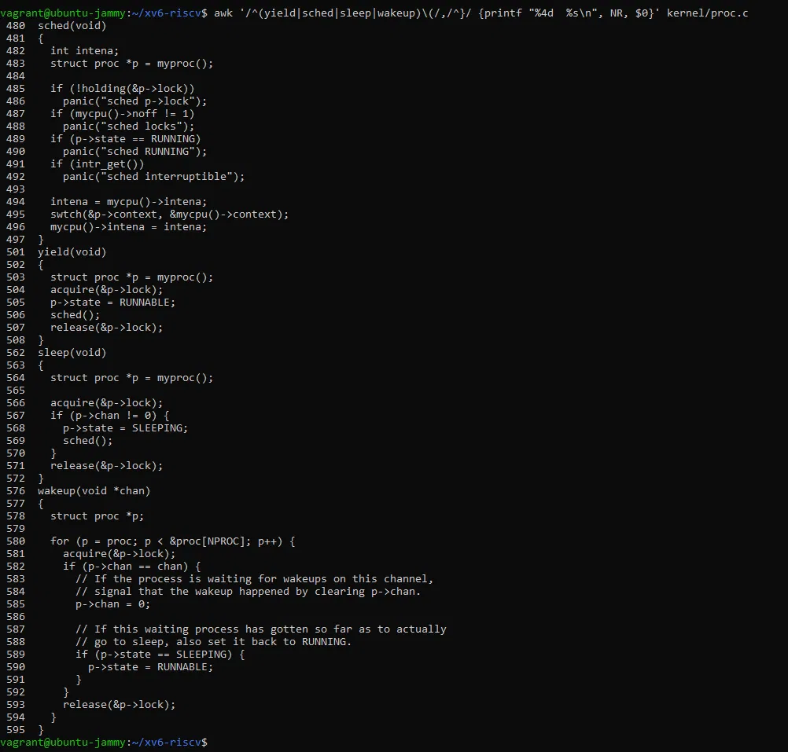

**Eventos por los que un proceso cede la CPU:**

**1. Se le acaba el tiempo (interrupción del reloj).** En `kernel/trap.c` (línea 179) se programa la próxima interrupción del reloj:

```c
179  w_stimecmp(r_time() + 1000000);
```

Cuando llega la interrupción (`which_dev == 2`), el kernel obliga al proceso a ceder la CPU:

```c
84  // give up the CPU if this is a timer interrupt.
85  if (which_dev == 2)
86    yield();
```

Esto ocurre en la línea 85, si el proceso estaba en modo usuario, y en las líneas 157 y 158, si estaba dentro del kernel. Luego `yield()` (líneas 501 a 508) cambia el estado de `RUNNING` a `RUNNABLE` y llama a `sched()`:

```c
501  yield(void)
502  {
503    struct proc *p = myproc();
504    acquire(&p->lock);
505    p->state = RUNNABLE;
506    sched();
507    release(&p->lock);
508  }
```

Como queda en `RUNNABLE`, el proceso sigue siendo candidato y volverá a ejecutarse cuando el planificador lo alcance otra vez en su recorrido. Por eso XV6 es **apropiativo** (*preemptive*): ningún proceso puede quedarse con la CPU indefinidamente.

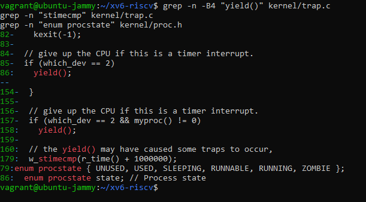

**2. Tiene que esperar algo (`sleep`).** `sleep()` (líneas 562 a 572) cambia el estado a `SLEEPING` y llama a `sched()`:

```c
567  if (p->chan != 0) {
568    p->state = SLEEPING;
569    sched();
570  }
```

Mientras esté en `SLEEPING`, el planificador lo salta. El campo `p->chan` (canal) indica qué evento espera.

**3. Termina.** Al finalizar (`kexit()`), el proceso pasa a `ZOMBIE` y no vuelve a ser elegido. *(Que `kexit()` también llama a `sched()` está pendiente de confirmar con `grep -n "sched()" kernel/proc.c`.)*

**Cómo se recupera la CPU:**
- **Un proceso dormido vuelve a ser candidato con `wakeup()`** (líneas 576 a 595): cuando ocurre el evento, `wakeup(chan)` recorre la tabla y a los procesos que esperaban en ese canal y están `SLEEPING` los cambia a `RUNNABLE` (líneas 589 y 590). No les entrega la CPU de inmediato: solo los vuelve elegibles.
- **Un proceso `RUNNABLE` recupera la CPU cuando `scheduler()` lo elige**: lo pasa a `RUNNING` (línea 451) y ejecuta el `swtch` de la línea 453. El proceso continúa justo después del `swtch` de la línea 495, dentro de `sched()`, regresa a `yield()` o `sleep()` y luego al programa de usuario, sin enterarse de que fue interrumpido.

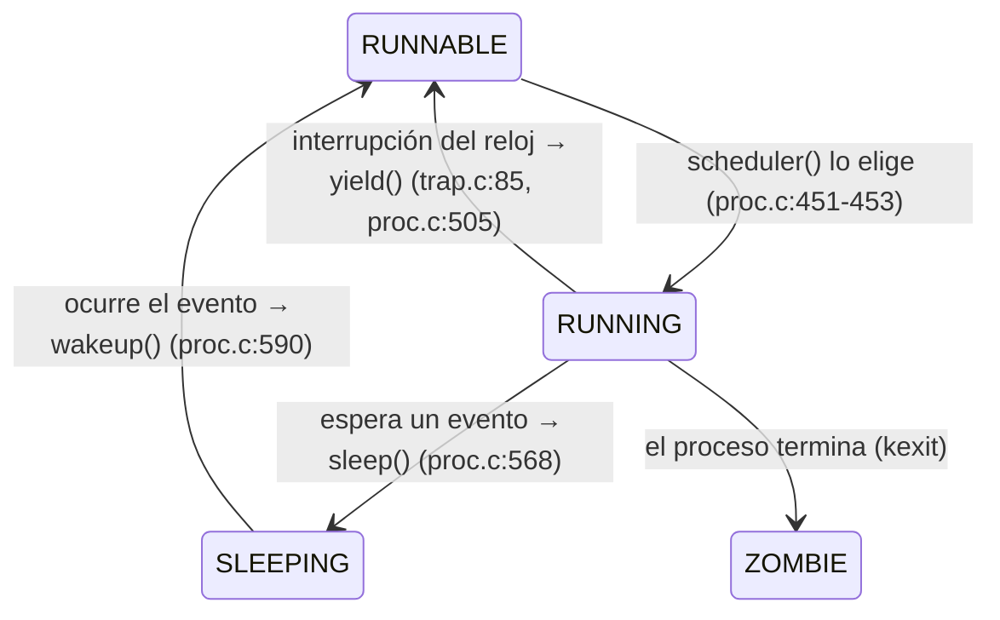

**En resumen:** el planificador solo elige entre procesos `RUNNABLE`. El proceso en `RUNNING` devuelve la CPU por tres motivos: se le acabó el quantum (pasa a `RUNNABLE`), debe esperar un evento (pasa a `SLEEPING`) o terminó (pasa a `ZOMBIE`). En todos los casos cambia su estado y llega a `sched()`, que hace el `swtch` de vuelta al planificador.

### 3.4 (iv) ¿Cómo se incorpora el planificador a la versión final del sistema operativo?

El planificador no es un programa aparte, sino una función **dentro del kernel**. El `Makefile` compila cada archivo del kernel por separado y luego los une en un solo ejecutable, `kernel/kernel`, que QEMU carga al arrancar.

**1. El `Makefile` incluye los archivos del planificador.** La variable `OBJS` (desde la línea 4) enumera los archivos objeto que forman el kernel:

```makefile
4   OBJS = \
5     $K/entry.o \
6     $K/start.o \
    ...
13    $K/main.o \
    ...
15    $K/proc.o \
16    $K/swtch.o \
    ...
```

- `$K/proc.o` sale de `kernel/proc.c`, que contiene `scheduler()`, `sched()`, `yield()`, `sleep()` y `wakeup()`.
- `$K/swtch.o` sale de `kernel/swtch.S`, el código en ensamblador del cambio de contexto.

**2. Compilación.** Cada archivo se compila con el compilador cruzado para RISC-V:

```
riscv64-linux-gnu-gcc -Wall -Werror ... -march=rv64gc ... -mcmodel=medany -ffreestanding ... -nostdlib ... -c -o kernel/proc.o kernel/proc.c
riscv64-linux-gnu-gcc -march=rv64gc -g ... -c -o kernel/swtch.o kernel/swtch.S
```

- `-c`: solo compila, sin enlazar.
- `-march=rv64gc`: genera instrucciones RISC-V de 64 bits, no x86.
- `-ffreestanding` y `-nostdlib`: el kernel no usa la biblioteca estándar de C, porque es él quien provee los servicios del sistema.

**3. Enlazado.** `riscv64-linux-gnu-ld` une todos los objetos en `kernel/kernel`, usando el script de enlazado `kernel/kernel.ld`:

```
riscv64-linux-gnu-ld -z max-page-size=4096 -T kernel/kernel.ld -o kernel/kernel kernel/entry.o kernel/start.o ... kernel/main.o kernel/vm.o kernel/proc.o kernel/swtch.o kernel/trampoline.o kernel/trap.o ...
```

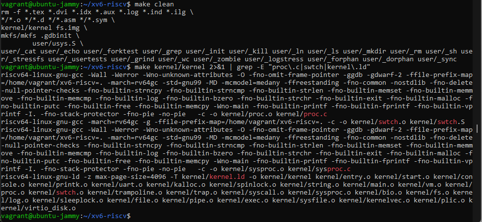

El script `kernel.ld` fija la dirección de inicio del kernel en `0x80000000`, que es a donde salta QEMU con `-kernel`, y coloca ahí `_entry` (de `entry.S`):

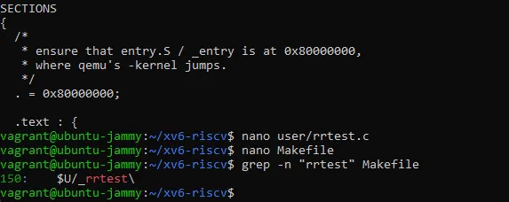

**Evidencia de que el planificador está en el ejecutable final.** Con `nm`, que lista los símbolos de un ejecutable:

```
$ riscv64-linux-gnu-nm kernel/kernel | grep -wE "scheduler|sched|yield|swtch"
0000000080001d26 T sched
0000000080001c72 T scheduler
00000000800022dc T swtch
0000000080001de0 T yield
```

La `T` indica que el símbolo está en la sección de código (*text*). Las direcciones empiezan en `0x80000000`, como define `kernel.ld`.

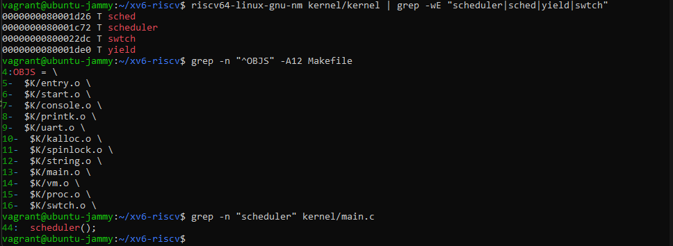

**4. Ejecución.** QEMU recibe el ejecutable con `-kernel kernel/kernel` (`QEMUOPTS`, línea 178 del `Makefile`). El arranque sigue la cadena:

1. `_entry` (`kernel/entry.S`): primer código ejecutado. Prepara una pila y salta a `start()`.
2. `start()` (`kernel/start.c`): configura la CPU y el reloj, y salta a `main()`.
3. `main()` (`kernel/main.c`): inicializa el sistema, crea el primer proceso y, en la línea 44, llama a `scheduler();`.
4. Desde ahí, cada CPU queda para siempre dentro de `scheduler()`.

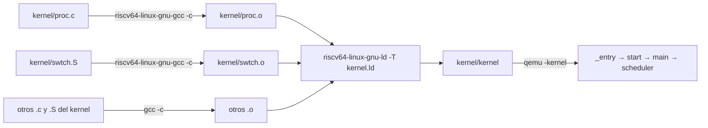

**Conclusión:** el planificador forma parte del kernel desde la compilación. Para cambiar el algoritmo (por ejemplo, a MLFQ) hay que modificar el código del kernel, principalmente `kernel/proc.c`, y reconstruirlo con `make`.

---

## 4. Describir MLFQ y explorar su incorporación

### 4.1 Descripción inicial de MLFQ (escrita antes de consultar a la IA)

> Versión original, sin correcciones, tal como la incluimos en el prompt 1.

**1. ¿Qué problema intenta resolver MLFQ? ¿Qué tiene de malo Round Robin solo?**

MLFQ busca mejorar la forma en que se ejecutan los procesos, ya que Round Robin trata a todos por igual sin importar si necesitan mucha o poca CPU. Esto puede ser un problema porque los procesos interactivos necesitan responder rápido, mientras que los procesos que hacen muchos cálculos pueden tardar bastante. MLFQ intenta dar prioridad a los procesos que necesitan respuestas rápidas y, al mismo tiempo, permite que los procesos más largos también puedan ejecutarse.

**2. Las reglas como las entendemos:**
- **Regla 1:** Si dos procesos tienen diferente prioridad, se ejecuta primero el que esté en la cola de mayor prioridad. Los de las colas inferiores deben esperar.
- **Regla 2:** Si dos procesos tienen la misma prioridad, se van turnando utilizando Round Robin, para que ambos tengan oportunidad de ejecutarse.
- **Regla 3:** Cuando aparece un proceso nuevo, entra a la cola de mayor prioridad, porque todavía no se sabe si va a necesitar mucha CPU o si será interactivo.
- **Regla 4:** Si un proceso consume todo el tiempo que tiene permitido en un nivel, baja al siguiente, incluso si ha soltado la CPU varias veces antes. Esto evita que algunos procesos intenten quedarse siempre en las colas superiores.
- **Regla 5:** Cada cierto tiempo todos los procesos vuelven a la cola de mayor prioridad. Esto sirve para que los procesos que llevan mucho tiempo abajo tengan otra oportunidad y no se queden esperando para siempre.

**3. Parámetros que el algoritmo necesita:**
- Número de colas: 3 colas, para tener una prioridad alta, una media y una baja.
- Quantum de cada cola: 5 ms para la primera, 10 ms para la segunda y 20 ms para la tercera.
- Tiempo permitido (allotment) por nivel: 10 ms en cada nivel antes de bajar de prioridad.
- Período del boost (S): 100 ms.

**4. Un ejemplo pequeño:** Si tenemos un proceso A que utiliza mucho la CPU y un proceso B que utiliza poco porque está esperando que el usuario escriba algo en el teclado, inicialmente ambos entran en la cola de mayor prioridad. Con el paso del tiempo, A va consumiendo sus tiempos de CPU y probablemente termina bajando a colas inferiores. Mientras tanto, B puede seguir teniendo una prioridad alta porque normalmente utiliza poco tiempo de CPU y después vuelve a esperar. De esta manera, cuando el usuario presione una tecla, B podría recibir atención más rápidamente que A. Sin embargo, A no deja de ejecutarse, sino que continúa teniendo oportunidades en las colas inferiores y también puede volver a subir cuando ocurra el boost.

**5. Nuestras dudas:**
- ¿Cómo decide el sistema operativo cuánto tiempo debe durar cada quantum para que los procesos interactivos respondan rápido sin perjudicar demasiado a los procesos largos?
- ¿Qué pasaría si el boost ocurre demasiado seguido? ¿Los procesos largos podrían quedarse siempre en las colas inferiores sin avanzar mucho?
- ¿El sistema operativo puede identificar correctamente cuándo un proceso es interactivo o simplemente se basa en observar cuánto tiempo utiliza la CPU?

### 4.2 Prompt 1

<details>
<summary><b>Ver el prompt 1 completo (clic para desplegar)</b></summary>

```
Actúa como tutor socrático de una pareja de estudiantes de cuarto semestre de
Ingeniería de Sistemas. Conocemos C++ y hemos comenzado a explorar XV6 para
RISC-V.

Queremos identificar y justificar qué se necesitaría para incorporar MLFQ a
XV6. En esta entrega no vamos a implementarlo.

Nuestra descripción inicial del algoritmo, escrita antes de esta conversación:

[La descripción completa de la sección 4.1 de este reporte: puntos 1 a 5,
con las reglas, los parámetros, el ejemplo y nuestras dudas.]

Lo que averiguamos del planificador original y de su incorporación al sistema
compilado:

Lo que averiguamos del planificador original de XV6 (RISC-V), ejecutado con
una sola CPU virtual (make CPUS=1 qemu):

- Política: Round Robin apropiativo, sin prioridades.
- Selección: kernel/proc.c, función scheduler() (líneas 421-470). Recorre la
  tabla proc[NPROC] (NPROC = 64) en orden y elige el primer proceso con
  p->state == RUNNABLE; lo pasa a RUNNING y le entrega la CPU con
  swtch(&c->context, &p->context) (línea 453). Al volver, continúa con el
  siguiente de la tabla.
- Estados (kernel/proc.h, línea 79): UNUSED, USED, SLEEPING, RUNNABLE,
  RUNNING, ZOMBIE. Cada proceso tiene su campo state (struct proc, línea 86).
- Ceder la CPU: sched() (proc.c, 480-497) hace swtch de vuelta al
  planificador (línea 495) y exige que el proceso ya no esté en RUNNING.
  * Por tiempo: kernel/trap.c programa la interrupción del reloj cada
    1.000.000 de ciclos (w_stimecmp, línea 179). En usertrap (líneas 85-86)
    y kerneltrap (157-158), si which_dev == 2 se llama a yield()
    (proc.c, 501-508), que pone al proceso en RUNNABLE.
  * Por espera: sleep() (proc.c, 562-572) lo pone en SLEEPING.
  * wakeup() (proc.c, 576-595) pasa los procesos de SLEEPING a RUNNABLE.
- Construcción: proc.o y swtch.o están en la lista OBJS del Makefile; se
  compilan con riscv64-linux-gnu-gcc y se enlazan con kernel/kernel.ld en
  kernel/kernel. main() (kernel/main.c, línea 44) llama a scheduler() al final
  del arranque.
- Experimento: con un programa propio (user/rrtest.c) que crea 3 hijos que solo
  usan CPU, observamos que se turnan en orden circular, cada turno dura cerca de
  un tick, y un proceso puede ser interrumpido a mitad de imprimir una línea.

Reglas de interacción:
1. Formula una sola pregunta principal por turno y espera nuestra respuesta. No
presentes una lista completa de cambios ni una arquitectura resuelta.
2. Empieza examinando nuestra descripción de MLFQ. Ayúdanos a detectar reglas
ambiguas, ausentes o contradictorias. No sustituyas nuestra descripción por una
versión terminada ni elijas silenciosamente una variante del algoritmo.
3. Pídenos que propongamos y justifiquemos las decisiones que faltan. Después,
ayúdanos a comprobarlas con ejemplos pequeños de procesos y decisiones de
planificación que nosotros debamos resolver.
4. Guíanos para relacionar cada regla con XV6. Antes de sugerir una modificación,
pregúntanos qué comportamiento necesitamos y qué evidencia del código respalda
nuestra propuesta.
5. No supongas que tienes acceso a nuestro repositorio. Pide los fragmentos
necesarios y distingue lo observado de lo que todavía sea una hipótesis. No
inventes archivos, funciones o comportamientos de nuestra versión.
6. No entregues código de implementación, parches, una lista cerrada de archivos
por modificar ni pseudocódigo que resuelva el planificador. Revisa nuestras
propuestas y señala problemas mediante preguntas y pistas graduales. Puedes
explicar conceptos previos con ejemplos mínimos.
7. Si nos bloqueamos, reduce la dificultad de la pregunta y ofrece una pista
concreta. Si pedimos la solución directa, conserva el modo socrático.

El objetivo es que nosotros logremos:
A. Redactar una descripción revisada y coherente de la variante de MLFQ
considerada.
B. Explicar qué cambios necesitaría XV6 para soportarla, indicando para cada uno
su propósito, su relación con las reglas y la evidencia del código que lo
justifica.
C. Proponer escenarios para comprobar una futura implementación del algoritmo
MLFQ en el sistema operativo XV6. Pídenos que expliquemos qué procesos
participarían, qué harían, qué regla comprobaríamos y qué comportamiento
esperaríamos observar. No nos entregues los escenarios resueltos. En esta tarea
solo los describiremos; no vamos a programarlos ni ejecutarlos.

Mantén el análisis dentro del alcance de una propuesta: no necesitamos
implementar MLFQ ni construir un selector de planificadores. Ayúdanos a
registrar las cuestiones que queden pendientes de investigación.

Al finalizar, pídenos que redactemos nuestras conclusiones. Comprueba su
consistencia mediante una última pregunta aplicada a un caso concreto, sin
escribir por nosotros el reporte.

Comienza con una pregunta que permita comprobar cómo entendemos una regla de
nuestra descripción inicial de MLFQ.
```

</details>

### 4.3 Descripción revisada de nuestra variante de MLFQ (objetivo A)

Nuestra variante de MLFQ busca darles prioridad a los procesos interactivos, que necesitan respuestas rápidas, sin impedir que los procesos que usan mucha CPU terminen. Usa tres colas (alta, media y baja) con distintas prioridades y tiempos.

#### Reglas

- **Regla 1 (prioridad y expropiación):** si un proceso de una cola de mayor prioridad pasa a estar listo, interrumpe **inmediatamente** al proceso de una cola inferior que se esté ejecutando.
- **Regla 2 (misma prioridad):** los procesos de una misma cola se reparten la CPU con Round Robin, usando el quantum de esa cola.
- **Regla 3 (procesos nuevos):** todo proceso nuevo entra a la cola alta, porque todavía no se sabe cuánto va a usar la CPU.
- **Regla 4 (degradación):** cuando un proceso acumula todo el allotment de su nivel, baja al siguiente, **aunque haya soltado la CPU varias veces**. El allotment es tiempo de CPU **acumulado** y no se reinicia cuando el proceso se bloquea.
- **Regla 5 (boost):** cada 100 ms todos los procesos vuelven a la cola alta.

#### Parámetros

| Parámetro | Cola alta | Cola media | Cola baja |
|---|---|---|---|
| Quantum | 5 ms (1 tick) | 10 ms (2 ticks) | 20 ms (4 ticks) |
| Allotment | 10 ms (2 ticks) | 10 ms (2 ticks) | **No se lleva** |
| Boost (S) | cada 100 ms (20 ticks), para todas las colas | | |

Los valores en ticks suponen el cambio de frecuencia del reloj propuesto en la sección 4.5 (un tick cada 5 ms).

#### Decisiones de diseño (surgidas en la conversación)

- **Decisión 1 (el allotment manda sobre el quantum):** si un proceso completa su allotment antes de terminar su quantum, baja de nivel en ese momento. Ejemplo: si le quedan 3 ms de allotment y 5 ms de quantum, solo ejecuta 3 ms antes de bajar. *(Ver en 4.6 el problema que esta decisión tiene con un reloj de ticks fijos.)*
- **Decisión 2 (la cola baja no lleva allotment):** como es el último nivel, agotar el allotment no tendría ninguna consecuencia. En la cola baja solo el quantum de 20 ms reparte la CPU entre procesos.
- **Decisión 3 (interrupción por prioridad):** un proceso de mayor prioridad que pasa a estar listo interrumpe de inmediato al que se está ejecutando. El proceso interrumpido **conserva el quantum que le quedaba**.
- **Decisión 4 (posición tras una interrupción):** el proceso interrumpido por otro de mayor prioridad conserva su quantum restante, pero **pasa al final de su cola**. Así pierde dos cosas: su lugar en la cola y la parte del turno que ya usó. Nos parece justo porque, si volviera al frente, tendría una ventaja constante sobre los demás procesos de su cola cada vez que lo interrumpen, y si recuperara el quantum completo, obtendría más CPU de la que le corresponde. En ambos casos el perjudicado sería otro proceso de su misma cola (por ejemplo, E frente a D).
- **Decisión 5 (reinicio en el boost):** en el boost todos los procesos van a la cola alta y se reinician su allotment y su quantum con los valores de esa cola. Lo que evita la hambruna es el **traslado** a la cola alta, no el reinicio del quantum. Reiniciar el quantum es una decisión de simplicidad: la ganancia que puede dar es de unos pocos milisegundos cada 100 ms, y a veces el proceso incluso pierde tiempo (un proceso con 7 ms de quantum pendientes pasa a tener 5 ms).

#### Comportamientos adicionales

- **Bloqueo y despertar:** si un proceso se bloquea por su cuenta (por ejemplo, B usa 1 ms de su quantum de 5 ms y se queda esperando el teclado), al despertar:
  - conserva su allotment acumulado (1 ms), lo que impide esquivar la Regla 4 bloqueándose;
  - conserva su quantum restante (4 ms), lo que impide obtener un turno completo nuevo cada vez que despierta y protege a los demás procesos de su cola;
  - vuelve al **final** de su cola, detrás de los que ya estaban esperando.
- **Al bajar de nivel:** el proceso llega a la nueva cola con el quantum de esa cola, con el allotment acumulado en cero y en la última posición.
- **Orden después del boost:** los procesos que ya estaban en niveles superiores conservan su orden relativo, y detrás se agregan los que vienen de colas inferiores, también en su orden. Ejemplo: C (venía de la cola media), D y E (venían de la cola baja) quedan en el orden C, D, E.

### 4.4 Lo que aprendimos: de la descripción inicial a la revisada

| Aspecto | Descripción inicial | Descripción revisada | Cómo lo descubrimos |
|---|---|---|---|
| Allotment frente a quantum | No decía cuál manda | El allotment manda (Decisión 1) | Caso del proceso C (3 + 4 + 6 ms) |
| Última cola | "Baja al siguiente nivel" sin decir qué pasa en la última. Allotment de 10 ms y quantum de 20 ms: el quantum nunca se usaba | En la cola baja no se lleva allotment (Decisión 2) | Casos de D, y de D y E en la cola baja |
| Proceso en ejecución cuando llega uno más prioritario | "Deben esperar", sin hablar del que ya se ejecuta | Expropiación inmediata y conserva el quantum restante (Decisión 3) | Caso de D interrumpido por B |
| Posición tras una interrupción | No definida | Al final de su cola (Decisión 4) | Línea de tiempo de D y E con B despertando cada 4 ms |
| Contadores en el boost | No definido | Se reinician (Decisión 5) | Caso de C, D y E en t = 100 ms |
| Bloqueo y despertar | No definido | Conserva allotment y quantum, y va al final | Pregunta sobre B bloqueándose tras 1 ms |
| Unidades de tiempo | Milisegundos | Ticks de 5 ms | Cálculo del tick de XV6 (≈ 100 ms) |
| El ejemplo del proceso B | "B puede seguir teniendo prioridad alta porque usa poco tiempo" | Como el allotment se acumula, un proceso interactivo también termina bajando si suma 10 ms de CPU. Por eso la Regla 5 es necesaria también para él | Al aplicar la Regla 4 de forma estricta |

Lo más importante que aprendimos es que **MLFQ no es un algoritmo cerrado**: las cinco reglas dejan muchas decisiones abiertas (qué manda, qué pasa en la última cola, qué se reinicia y cuándo), y cada una cambia cómo se reparte la CPU. También aprendimos que **las reglas teóricas chocan con el hardware**: un kernel que solo se entera del tiempo en cada tick no puede aplicar reglas exactas al milisegundo.

### 4.5 Propuesta de cambios en XV6 (objetivo B)

Esta no es una lista cerrada de archivos que modificar, sino de **necesidades**. Para cada una indicamos qué necesidad atiende, por qué, qué regla o decisión respalda, en qué parte del código se relaciona y si la evidencia está **observada** en nuestro código o es una **hipótesis**.

#### Cambio 1: aumentar la frecuencia del reloj a un tick cada 5 ms

- **Necesidad:** representar quantums de 5, 10 y 20 ms con un número entero de ticks.
- **Por qué:** suponiendo que el contador de tiempo de QEMU va a 10 MHz, 1.000.000 de unidades equivalen a 0,1 s, o sea **1 tick ≈ 100 ms**. Con eso, el quantum de la cola alta sería 0,05 ticks, imposible de representar. Cambiar la unidad (expresar todo en ticks) no resuelve el problema de precisión; aumentar los quantums a múltiplos de 100 ms haría que los procesos interactivos respondieran más lento.
- **Reglas:** 2 y 4 (quantum y allotment) y 5 (boost de 20 ticks).
- **Dónde:** `kernel/trap.c`, línea 179: `w_stimecmp(r_time() + 1000000);`.
- **Evidencia:** la línea de `trap.c` está **observada**. La frecuencia de 10 MHz y la duración de 100 ms son una **hipótesis** (dato del tutor, pendiente de confirmar con el comentario junto a la línea 179).
- **Costo:** más interrupciones por segundo, es decir, más trabajo del procesador. Además, otras partes del kernel miden el tiempo en ticks (por ejemplo, un programa que hace `sleep(10)` dormiría 50 ms en lugar de 1 s). Ver pendientes.

#### Cambio 2: guardar en cada proceso su información de planificación

- **Necesidad:** que cada proceso tenga su cola actual, su allotment acumulado y su quantum restante, y que el planificador elija según la cola.
- **Por qué:** sin esa información no se pueden aplicar las reglas 1 a 4 ni las Decisiones 1 a 4. Además, todo proceso nuevo debe empezar en la cola alta con los contadores en cero (Regla 3).
- **Reglas:** 1, 2, 3 y 4, y Decisiones 1 a 4.
- **Dónde:** `struct proc` en `kernel/proc.h` (hoy guarda el estado en el campo `state`, línea 86) y `scheduler()` en `kernel/proc.c` (líneas 445 a 463), que hoy elige el primer proceso `RUNNABLE` de la tabla, sin prioridades.
- **Evidencia:** el campo `state` y la selección sin prioridades en `scheduler()` están **observados**. Que `struct proc` no tenga ningún campo de prioridad o de tiempo acumulado está **pendiente**: solo revisamos el campo `state`, no la estructura completa.

#### Cambio 3: medir el uso real de CPU entre los dos `swtch`

- **Necesidad:** sumar al allotment el tiempo de CPU realmente usado, y no solo los ticks en los que el reloj encuentra al proceso ejecutándose.
- **Por qué:** si el allotment se contara por muestreo en cada tick, un proceso como G (que se ejecuta 4 ms y se bloquea 2 ms, y al que los ticks siempre encuentran bloqueado) usaría unos 66,7 ms de CPU cada 100 ms sin que se le contara nada, y nunca bajaría de cola. Eso contradice la Regla 4.
- **Reglas:** 4 y Decisión 1.
- **Dónde:** guardar el instante de inicio cuando el planificador entrega la CPU (`swtch(&c->context, &p->context)`, `kernel/proc.c:453`) y sumar la diferencia cuando el proceso la devuelve (`swtch` dentro de `sched()`, `kernel/proc.c:495`). Fuente de tiempo: `r_time()`, que aparece en `kernel/trap.c:179`.
- **Evidencia:** los dos `swtch` están **observados**, y también que `yield()` (línea 506) y `sleep()` (línea 569) pasan por `sched()`. Que `kexit()` también pase por `sched()` está **pendiente**. Que `r_time()` se pueda leer en esos puntos del kernel es **hipótesis**.
- **Nota:** este intervalo mide tiempo de CPU y no tiempo transcurrido, porque no incluye los periodos en los que el proceso está bloqueado.

#### Cambio 4: mecanismo global de boost

- **Necesidad:** un contador global que, cada 20 ticks (100 ms), pase todos los procesos a la cola alta y reinicie sus contadores.
- **Por qué:** sin el boost, los procesos de la cola baja pueden quedarse sin CPU para siempre (ver el escenario de los kamikazes en 4.7).
- **Reglas:** 5 y Decisión 5.
- **Dónde:** el manejo de la interrupción del reloj en `kernel/trap.c`, que ya se ejecuta en cada tick (`which_dev == 2`, líneas 85 y 157).
- **Evidencia:** que el kernel recibe una interrupción en cada tick está **observado**. Que ese sea el lugar adecuado para el boost es **hipótesis**.

#### Cambio 5: expropiación al despertar un proceso de mayor prioridad

- **Necesidad:** que, cuando `wakeup()` pase a `RUNNABLE` un proceso de mayor prioridad que el que se está ejecutando, este último ceda la CPU sin esperar al siguiente tick.
- **Por qué:** hoy, si una tecla llega 1 ms después de un tick, el proceso de menor prioridad puede seguir ejecutándose hasta 4 ms más (con ticks de 5 ms) antes de que el interactivo entre. La Regla 1 dice "inmediatamente".
- **Reglas:** 1 (opción a) y Decisión 3.
- **Dónde:** `wakeup()` en `kernel/proc.c` (líneas 576 a 595) cambia el estado a `RUNNABLE` (líneas 589 y 590). La cesión de CPU **no** debería hacerse dentro de `wakeup()`, porque `wakeup()` se llama desde muchos lugares del kernel, a veces con candados (*locks*) tomados. Debería hacerse en un punto seguro después de atender la interrupción.
- **Evidencia:** que `wakeup()` solo cambia el estado y que hoy `yield()` solo se llama cuando `which_dev == 2` está **observado** (`kernel/trap.c`, líneas 85-86 y 157-158). Qué valor de `which_dev` corresponde al teclado y dónde es seguro llamar a `yield()` está **pendiente**.

#### Cambio 6: aplicar la degradación en el momento exacto (dos alternativas)

En la pregunta final de consistencia descubrimos que, aunque midamos el uso de CPU con precisión (cambio 3), **nada hace que el kernel actúe en el instante en que un proceso agota su allotment** si ese instante cae entre dos ticks. Por eso proponemos dos alternativas, sin elegir todavía (ver 4.6).

**Alternativa 1: temporizador programado según el proceso (sin hardware nuevo).**
- **Propuesta:** en lugar de programar siempre la siguiente interrupción 1.000.000 de unidades más adelante, el kernel la programa para el momento exacto en que el proceso actual agotaría su quantum o su allotment.
- **Evidencia:** la línea `w_stimecmp(r_time() + 1000000)` está **observada**: es el propio kernel quien escribe ese intervalo cada vez. Que pueda escribir cualquier valor ahí sin afectar otras partes del kernel es **hipótesis**.
- **Costo:** más complejidad en cada cambio de contexto (calcular el tiempo restante, convertirlo a unidades del reloj y programar el temporizador). Además, si el intervalo deja de ser fijo, hay que redefinir qué significa "un tick" para `sleep()` y `uptime()`.
- **Relación con la Decisión 1:** permite cumplirla de forma exacta.

**Alternativa 2: muestreo retrasado (relajar la Decisión 1).**
- **Propuesta:** mantener los ticks fijos de 5 ms y degradar al proceso en el primer tick después de que agote su allotment.
- **Costo:** un proceso puede pasarse casi un tick completo (casi 5 ms sobre un allotment de 10 ms, cerca del 50 %). Este error depende del tamaño del tick y no del algoritmo: si la frecuencia cambia, el problema cambia de escala, pero sigue existiendo.
- **Relación con la Decisión 1:** obliga a relajarla. Si además se quisiera "descontar" el exceso en el nivel siguiente, chocaría con que el allotment empieza en cero al bajar de nivel y con que la cola baja no lleva allotment.

### 4.6 Decisiones de la propuesta que necesitan soporte adicional

1. **Alternativa 1 frente a Alternativa 2** para cumplir la Decisión 1 con un reloj de ticks. Es la principal cuestión abierta de nuestra propuesta.
2. **Regla 1, opción (a) "inmediatamente" frente a opción (b) "en el siguiente tick".** Elegimos (a), pero con (b) el retraso máximo sería de un tick (5 ms), que probablemente una persona no alcanza a percibir al escribir. Hay que comparar ese beneficio con el costo de modificar el flujo de interrupciones.
3. **La duración real del tick (≈ 100 ms)**, de la que depende el cambio 1.
4. **Si el tiempo que el proceso pasa dentro del kernel** (en sus llamadas al sistema o atendiendo interrupciones de otros dispositivos) debe contar en su allotment.
5. **La herencia en `fork()`** (pregunta de nuestra variante, no de XV6): si un hijo siempre entra a la cola alta con allotment completo (Regla 3), un proceso puede evitar la degradación creando hijos en cadena. ¿Debería el hijo heredar la cola y la contabilidad del padre?

### 4.7 Escenarios para comprobar una futura implementación (objetivo C)

> Solo se describen. No se programaron ni se ejecutaron.

#### Escenario 1: G y H, la Regla 4 no se puede esquivar bloqueándose

- **Procesos:**
  - **G:** repite muchas veces un ciclo de ejecutar un poco (incrementando un contador propio de iteraciones) y bloquearse un intervalo corto. Como un programa de usuario no controla cuándo llegan los ticks, G repite el ciclo muchas veces, hasta superar con creces 10 ms de CPU, para no depender de una coincidencia exacta.
  - **H:** usa el mismo ciclo contador, pero nunca se bloquea. Sirve como **regla de medición**: como siempre está ejecutándose, todos los ticks lo encuentran en la CPU, así que una contabilidad exacta y una por muestreo darían prácticamente el mismo resultado para H. El número de iteraciones que H alcanza antes de bajar de cola equivale a un allotment real de CPU.
- **Regla que comprueba:** Regla 4 (allotment acumulado) y el cambio 3 (medir el uso real de CPU).
- **Resultado esperado:**
  - **Correcto:** G baja de cola cuando su contador de iteraciones está cerca de las iteraciones que logró H antes de degradarse (con un pequeño margen por el costo de bloquearse y despertar).
  - **Incorrecto:** G hace muchas más iteraciones que H (el doble o el triple) antes de bajar, o nunca baja. Eso mostraría que el tiempo de G no se registra cuando ningún tick lo encuentra ejecutándose.
- **Cómo observarlo:** el contador de iteraciones lo lleva el propio programa, así que es una medida **independiente** de la contabilidad del kernel. El kernel debería mostrar (con mensajes de depuración que hoy no existen en XV6) el PID, la cola y el momento de cada degradación. *(Pendiente: cómo saber cuánto valía el contador de G justo cuando el kernel lo bajó de cola.)*

#### Escenario 2: los kamikazes, la Regla 5 evita la hambruna

- **Procesos:**
  - **L:** proceso de cálculo puro, con un contador de iteraciones. Arranca primero, gasta su allotment y cae a la cola baja.
  - **K (kamikaze):** proceso en la cola alta que gasta casi todo su allotment (por ejemplo, 9 ms), crea un hijo con `fork()` y termina. El hijo entra nuevo a la cola alta (Regla 3) con su allotment completo y repite lo mismo, formando una cadena que siempre ocupa la cola alta.
  - Primero habíamos propuesto dos procesos interactivos (I1 e I2) turnándose, pero no sirve: si usan CPU, la Regla 4 termina bajándolos de cola; y si se bloquean mucho, la cola alta queda vacía y L sí se ejecuta. Solo un proceso **recién creado** tiene el allotment completo en la cola alta.
- **Regla que comprueba:** Regla 5 (boost).
- **Resultado esperado:**
  - **Correcto:** cada 100 ms el boost sube a L a la cola alta, donde compite con el kamikaze de turno (Regla 2), y su contador avanza a saltos periódicos.
  - **Incorrecto:** después de caer a la cola baja, el contador de L **deja de avanzar** indefinidamente, mientras los kamikazes se reparten toda la CPU.
- **Cómo observarlo:** registrar el contador de L junto con marcas de tiempo cada vez que avanza.

#### Escenario 3: el teclado, la Regla 1 con expropiación inmediata

- **Procesos:**
  - **P (pesado):** proceso de cálculo en la cola baja que se está ejecutando.
  - **A (interactivo):** proceso en la cola alta, bloqueado en un `read()` del teclado.
- **Regla que comprueba:** Regla 1 opción (a) y Decisión 3.
- **Por qué el teclado:** si A esperara un `sleep()`, lo despertaría la interrupción del reloj, así que su despertar siempre coincidiría con un tick y no se podría distinguir "inmediatamente" de "en el siguiente tick". La llegada de una tecla no está atada al tick.
- **Resultado esperado:**
  - **Correcto:** la diferencia entre el instante de la interrupción del teclado (T1) y el instante en que A vuelve a ejecutarse (T2) es muy pequeña, del orden del costo de un cambio de contexto.
  - **Incorrecto:** T2 − T1 es de varios milisegundos (hasta un tick), porque P siguió ejecutándose hasta la siguiente interrupción del reloj.
- **Cómo observarlo:** el kernel anota T1 en el manejador de la interrupción del teclado y A anota T2 apenas despierta. Como fuente de tiempo de alta resolución usaríamos el contador `time` de RISC-V (`rdtsc` es de x86, no sirve). *(Hipótesis: que un programa de usuario pueda leer ese contador directamente; si no, haría falta una llamada al sistema nueva. Pendiente: confirmar que el manejador del teclado es `uartintr` y en qué función se llama a `wakeup()` para el proceso bloqueado en `read()`.)*

### 4.8 Pendientes de investigación

| # | Pendiente | Relacionado con |
|---|---|---|
| 1 | Confirmar en el comentario junto a la línea 179 de `kernel/trap.c` cuánto dura un tick (hoy, ≈ 100 ms es hipótesis). | Cambio 1 |
| 2 | Revisar qué partes del kernel usan el contador de ticks (dónde se incrementa, quién lo lee, `sleep()`, `uptime()`) y qué les pasaría con ticks de 5 ms o con un intervalo variable. ¿Qué significa "un tick" si el intervalo deja de ser fijo? | Cambios 1 y 6 |
| 3 | Confirmar que `kexit()` también llega a `sched()`. | Cambio 3 |
| 4 | Revisar `struct proc` completa en `kernel/proc.h`. | Cambio 2 |
| 5 | Confirmar que `r_time()` se puede usar dentro de `sched()` y de `scheduler()`. | Cambio 3 |
| 6 | Decidir si el tiempo dentro del kernel cuenta en el allotment. | Cambio 3 |
| 7 | Encontrar qué valor de `which_dev` corresponde al teclado o la consola, y un punto seguro para llamar a `yield()` sin candados tomados. | Cambio 5 |
| 8 | Comparar el costo y el beneficio de la opción (a) frente a la (b) de la Regla 1. | Cambio 5 |
| 9 | Elegir entre la Alternativa 1 y la Alternativa 2. | Cambio 6 |
| 10 | Decidir si un hijo creado con `fork()` hereda la cola y la contabilidad del padre. | Regla 3 (variante) |
| 11 | Cómo sincronizar el contador de G con el instante en que el kernel lo degrada. | Escenario 1 |
| 12 | Si un programa de usuario puede leer el contador `time` de RISC-V o si hace falta una llamada al sistema. | Escenario 3 |
| 13 | Confirmar que el manejador del teclado es `uartintr` y dónde se llama a `wakeup()` para un `read()` de consola. | Escenario 3 |

### 4.9 Conclusiones y retroalimentación de la IA

**Nuestras conclusiones:**

1. **Nuestra variante** es un MLFQ de tres colas basado en las cinco reglas de OSTEP, completado con cinco decisiones propias: el allotment manda sobre el quantum, la cola baja no lleva allotment, un proceso más prioritario expropia de inmediato, el proceso interrumpido va al final de su cola conservando su quantum, y el boost reinicia los contadores. Además, definimos qué pasa al bloquearse, al bajar de nivel y en el orden tras el boost.
2. **Para soportarla, XV6 necesitaría:** ticks más frecuentes, información de planificación por proceso, medir el uso real de CPU entre los dos `swtch`, un boost global, expropiación al despertar y un mecanismo para degradar en el momento justo.
3. **El hallazgo más importante** salió de la pregunta final: con reglas exactas al milisegundo y un kernel que solo se entera del tiempo en cada tick, la Decisión 1 no se puede cumplir. En el caso de prueba, Y debía bajar en t = 12 ms y X en t = 14 ms, pero los ticks llegan en t = 10 y t = 15. Como resumimos durante la conversación: *"estábamos pidiendo reglas matemáticas perfectas sobre un reloj que funciona a saltos"*. Por eso dejamos dos alternativas documentadas en lugar de elegir una sin evidencia.
4. **Sobre nuestras dudas iniciales:** el sistema operativo no identifica directamente si un proceso es interactivo; lo deduce observando cuánta CPU acumula (Reglas 3 y 4). Y el boost no deja a los procesos largos abajo, sino lo contrario: los sube periódicamente. El riesgo de un boost muy frecuente es que los procesos interactivos pierdan su ventaja.

**Retroalimentación de la IA (resumen):**
- Al revisar nuestras conclusiones, el tutor señaló que les faltaban las Decisiones 1 a 5, el cambio de frecuencia del reloj y varios pendientes, y que algunas etiquetas de evidencia estaban mal (la expropiación por `which_dev == 2` sí era observada, y lo de `struct proc` no lo habíamos revisado completo). Lo corregimos en este reporte.
- En la pregunta final nos hizo ver que nuestra línea de tiempo contradecía nuestra propia Decisión 4. La rehicimos y la validó: *"pasaron la prueba de consistencia: el caso combinó las Reglas 1, 2 y 4, las Decisiones 1 y 4 y la granularidad del reloj, y todo encaja"*.
- Su evaluación final fue que los tres objetivos quedaron cubiertos (A: una variante coherente, B: necesidades de cambio ligadas a reglas con la evidencia clasificada, C: tres escenarios con diferencias observables) y que la lista de pendientes deja claro hasta dónde llega la propuesta.

---

## 5. Evidencia del aprendizaje con IA

**Servicio y modelo:** Claude (claude.ai), modelo Claude Sonnet 5.5. Conversación realizada el 13 de noviembre de 2026, en un chat nuevo, usando el prompt 1 de la sección 4.2. La conversación completa está en [`conversacion_tutoria_MLFQ_XV6.txt`](conversacion_tutoria_MLFQ_XV6.txt).

### 5.1 Intercambios seleccionados

#### Intercambio 1: hipótesis (el allotment manda sobre el quantum)

> **IA:** Caso: un proceso C acaba de llegar a la cola alta. Usa la CPU 3 ms y se bloquea; se despierta, usa 4 ms y se bloquea; se despierta y quiere usar 6 ms seguidos. Según su Regla 4 y sus parámetros, ¿en qué momento exacto baja C a la cola media?
>
> **Nosotros:** C baja a la cola media exactamente después de ejecutar 3 ms de su tercera ejecución. En ese momento lleva 10 ms acumulados. [...] Inicialmente podríamos pensar que, como el quantum es de 5 ms, C tendría que terminar sus 5 ms antes de bajar. Sin embargo, la regla 4 habla del tiempo acumulado (allotment) y no solamente del quantum.
>
> **IA:** Es una decisión válida y está bien justificada: el allotment manda sobre el quantum. [...] Anótenla como Decisión 1, porque el texto original no lo decía.

**Qué muestra:** formulamos una hipótesis para resolver una ambigüedad de nuestra descripción, y se convirtió en la Decisión 1.

#### Intercambio 2: comprobación que revela huecos (la última cola)

> **IA:** El proceso D solo hace cálculos y ya está en la cola baja. Quiere usar la CPU 30 ms seguidos. ¿Qué le pasa cuando cumple 10 ms? ¿Y a los 20 ms? [...] En la cola baja, ¿llega a usarse en algún momento el quantum de 20 ms?
>
> **Nosotros:** Encontramos un problema: la cola baja es la última, así que no existe otra cola a la cual pueda bajar. [...] Nos damos cuenta de que, con los parámetros actuales, el quantum de la cola baja nunca llegaría a utilizarse completamente, porque el allotment se agota a los 10 ms.

**Qué muestra:** al comprobar nuestras reglas con un caso concreto descubrimos dos huecos de nuestra descripción inicial, que resolvimos con la Decisión 2.

#### Intercambio 3: corrección (¿a quién perjudica reiniciar el quantum?)

> **IA:** Dicen que si D recuperara los 20 ms completos, "perjudicaría a los procesos de mayor prioridad". Piensen en esto: cada vez que B se despierta, interrumpe a D de todas formas, así que B no pierde nada. Entonces, ¿quién sale perjudicado?
>
> **Nosotros:** Primero corregimos nuestra justificación anterior: si D recuperara sus 20 ms completos, quien realmente saldría perjudicado sería E, porque D podría acumular más tiempo de ejecución que otros procesos de su misma cola. B no sería el perjudicado.

**Qué muestra:** corregimos un error de razonamiento. Después, al hacer la línea de tiempo con números, también descubrimos que la verdadera injusticia era reiniciar el quantum y no la posición en la cola.

#### Intercambio 4: comprobación (contar el allotment por muestreo permite hacer trampa)

> **IA:** El proceso G se ejecuta 4 ms, se bloquea 2 ms y vuelve a ejecutarse. Supongan que cada interrupción del reloj llega justo cuando G está bloqueado. Al cabo de 100 ms, ¿cuánta CPU usó G en realidad y cuánto allotment le contó el kernel?
>
> **Nosotros:** G utiliza aproximadamente 66,67 ms de CPU [...] pero el kernel no le cuenta ningún allotment. G nunca bajaría de cola, aunque realmente utilizó más de seis veces el allotment permitido. Esto contradice nuestra Regla 4.

**Qué muestra:** comprobamos con números que una implementación ingenua rompería la Regla 4, y eso motivó el cambio 3 (medir entre los dos `swtch` con `r_time()`).

#### Intercambio 5: corrección en la prueba final de consistencia

> **IA:** Revisen t = 2 con la Decisión 4. Escribieron que cuando A se bloquea, el planificador "le devuelve la CPU a X". Pero la Decisión 4 dice que un proceso interrumpido pasa al final de su cola. ¿Quién estaba en la cola media cuando A interrumpió a X?
>
> **Nosotros:** Tienes toda la razón, se nos cruzaron los cables con nuestra propia Decisión 4. Como X fue expropiado, se va al final de la cola media [...] La cola media ahora está así: [Y, X]. [...] Y debería bajar exactamente en t = 12, y X en t = 14. Ninguno de los dos coincide con los ticks fijos del reloj (t = 10 o t = 15).

**Qué muestra:** en la prueba de consistencia detectamos que contradecíamos una decisión propia, rehicimos la línea de tiempo y llegamos al hallazgo principal de la propuesta (la Decisión 1 frente al reloj de ticks).

### 5.2 Reflexión individual

**Samuel David Duarte Soto:**

En este trabajo comprendí cómo la teoría pura de los planificadores choca con las limitaciones del hardware, especialmente al darnos cuenta de que las reglas de MLFQ al milisegundo son muy difíciles de implementar sobre un reloj de ticks fijos en XV6. Mi principal aporte al equipo fue la preparación del entorno, resolviendo el problema de memoria al compilar QEMU 8.2.2, y la creación del experimento rrtest.c que nos permitió comprobar empíricamente la política Round Robin original. Además, lideré la definición de los escenarios de prueba como el de los procesos "kamikaze". La cuestión que todavía necesito estudiar con mayor profundidad es cómo funciona internamente el código en ensamblador de la función swtch y cómo se manejan exactamente los registros de la CPU durante ese cambio de contexto.

**Nohaysi Montaño:**

Gracias a esta exploración logré desmitificar el planificador del sistema operativo; entendí que no es un ente mágico, sino un ciclo infinito en la función scheduler() que simplemente recorre el arreglo de procesos buscando el estado RUNNABLE. Aporté principalmente en la redacción y refinamiento de nuestra variante de MLFQ, el análisis de las funciones en proc.c y trap.c, y en guiar la conversación socrática con la IA donde descubrimos la necesidad de separar el concepto de *allotment* del *quantum*. Lo que aún necesito investigar e interiorizar más es el manejo de los candados (*locks*) en XV6; me sigue costando asimilar la lógica de concurrencia y por qué exactamente no se puede llamar a funciones como yield() o wakeup() cuando ciertos candados están tomados.

---

## 6. Bibliografía

- Arpaci-Dusseau, R. H. y Arpaci-Dusseau, A. C. *Operating Systems: Three Easy Pieces*, capítulo "Scheduling: The Multi-Level Feedback Queue". https://pages.cs.wisc.edu/~remzi/OSTEP/cpu-sched-mlfq.pdf
- Vídeo del curso: "OSTEP_08_MLFQ". https://www.youtube.com/watch?v=wGiaEc2Symc
- Cox, R., Kaashoek, F. y Morris, R. *xv6: a simple, Unix-like teaching operating system* (libro de XV6 para RISC-V), capítulo sobre planificación.
- Repositorio oficial de XV6 para RISC-V: https://github.com/mit-pdos/xv6-riscv
- MIT 6.1810, página de herramientas (*Tools*): https://pdos.csail.mit.edu/6.1810/
